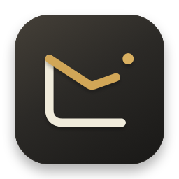
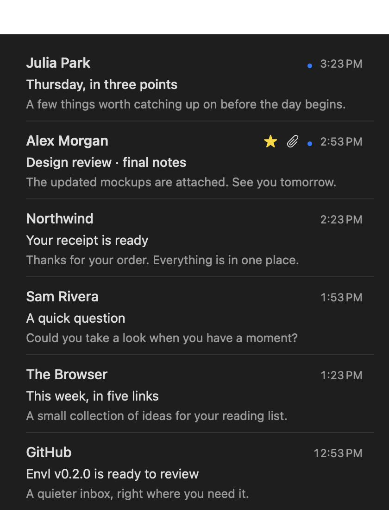
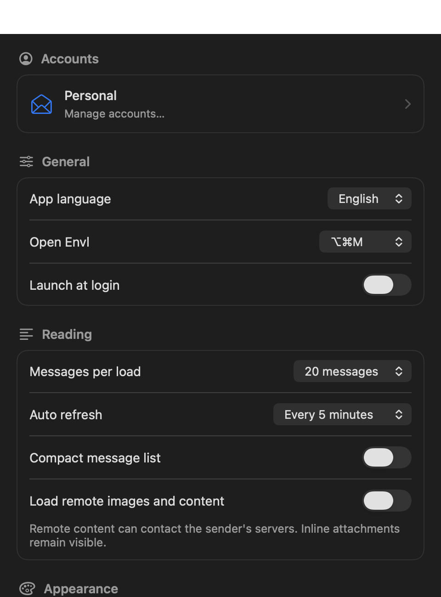

<p align="center">
  
</p>
<h1 align="center">Envl</h1>
<p align="center">A quick look at your inbox. Right in the Mac menu bar.</p>
<p align="center">
  <a href="https://github.com/berkinduz/menu-mail/releases"><strong>Downloads</strong></a> ·
  <a href="README.tr.md">Türkçe</a> ·
  <a href="https://github.com/berkinduz/menu-mail/issues">Feedback</a>
</p>

Envl is a free, open-source **macOS menu bar email reader**. Take a quick look at the accounts already in Apple Mail, open a message or attachment, then get back to work. Previously named MenuMail.

<p align="center">
  
</p>

## Install

Requires **macOS 14 or later**. The universal app includes Apple silicon and Intel executables.

```sh
brew tap berkinduz/tap https://github.com/berkinduz/tap
brew install --cask berkinduz/tap/envl
```

Or download **Envl.dmg** from [Releases](https://github.com/berkinduz/menu-mail/releases), drag **Envl** to **Applications**, then open it. Using the downloaded app does not require Xcode.

The current package is **not notarized**. If macOS requests approval, follow [Apple’s opening instructions](https://support.apple.com/en-us/102445).

## Connect Apple Mail

1. Make sure your account is **added to Apple Mail and syncing** on this Mac. This includes Gmail, iCloud and corporate Exchange accounts supported by Mail. Your organization’s access policies still apply.
2. Click the Fold envelope in the menu bar and choose **Load Apple Mail accounts**.
3. Allow macOS **Automation access** to Mail when prompted, then choose your account and mailbox.

Apple Mail handles sign-in and synchronization. **Envl does not need its own Google or Microsoft application registration.** Apple Mail must keep running to sync messages, and its Dock icon remains visible.

This release is **read only**. Envl does not send, archive, delete or change message read status. Opening a message never marks it read.

| Connection | Status |
| --- | --- |
| **Apple Mail** | Available · read only |
| **Independent Gmail sign-in** | Coming soon |
| **Independent Outlook / Microsoft 365 sign-in** | Coming soon |

Gmail and Outlook are informational rows in the account screen; they do not start sign-in in this release.

## Made for a quick check

- **One quiet toolbar.** Search expands smoothly to the left of its icon. Account selection and All, Unread, Starred and Attachments filters share one popover.
- **A readable inbox.** Larger text, aligned message rows, optional compact spacing and automatic loading as you scroll.
- **A complete reader.** HTML and plain text, recipients, attachment open/save and a separate reader window. Remote images and content stay blocked until enabled. Search works on loaded messages.
- **Your preferences.** Optional notifications with preview controls, per-account mutes and quiet hours; manual/automatic refresh; light/dark themes; unread count; Fold and four alternative menu bar icons.
- **Native controls.** Optional launch at login, manual or launch-time update checks, and English/Türkçe UI. About lives at the bottom of Settings.

Use **↑ / ↓** to browse, **Return** to open and **Escape** to go back. **⌥⌘M** toggles Envl; choose **⌃⌥M** or turn off the global shortcut in Settings.

<details>
  <summary>Settings preview</summary>
  <p></p>
</details>

Screenshots show the current interface with synthetic example messages.

## Privacy

Envl has no backend, analytics or message logs. This release does not sign in to providers or access provider tokens. Account selections and preferences stay in local UserDefaults; messages and downloaded attachments stay in memory. Opening an attachment creates a temporary local file; saving writes to your chosen destination. Notifications are opt in. Update checks contact GitHub’s public releases API. [Data, permissions and file lifecycle](docs/PRIVACY.md).

## Build and contribute

```sh
git clone https://github.com/berkinduz/menu-mail.git
cd menu-mail
bash scripts/build.sh
open build/Envl.app
```

Building requires **Swift 6+** and macOS 14+. Run `swift test` for behavior checks, or `bash scripts/package.sh` to create universal **Envl.dmg**, **Envl.zip**, checksums and a pinned Homebrew cask. See [distribution setup](docs/DISTRIBUTION.md) for package checks and optional Developer ID signing/notarization.

Bug reports, translations, accessibility fixes and focused pull requests are welcome. [Contributor guide](CONTRIBUTING.md).

---

Made by [berkinduz](https://github.com/berkinduz) · [Contact](mailto:mberkinduz@gmail.com) · [MIT License](LICENSE)
