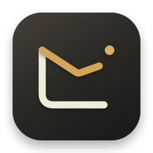
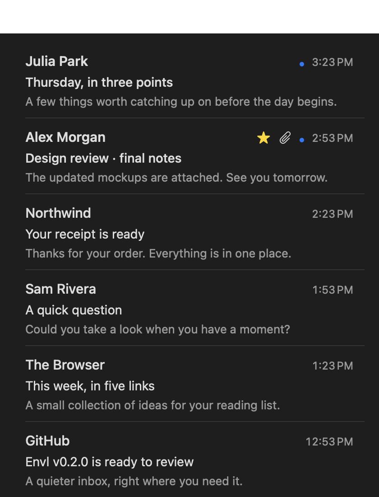
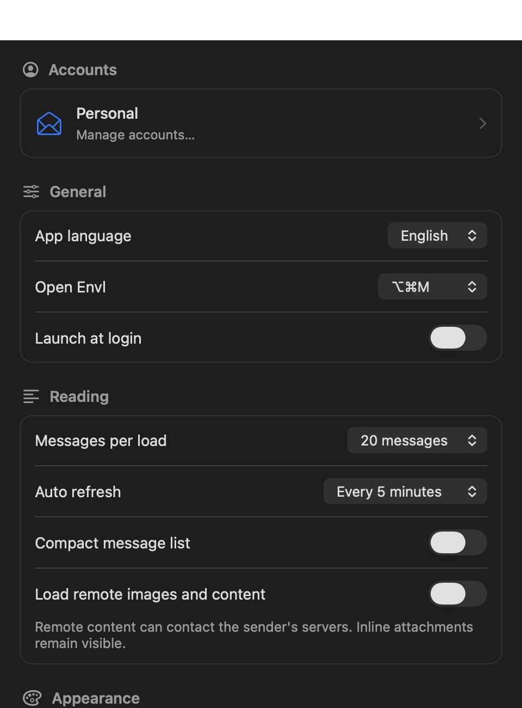

<p align="center">
  
</p>
<h1 align="center">Envl</h1>
<p align="center">Gelen kutuna hızlıca göz at. Mac’in menü çubuğundan.</p>
<p align="center">
  <a href="https://github.com/berkinduz/menu-mail/releases"><strong>İndir</strong></a> ·
  <a href="README.md">English</a> ·
  <a href="https://github.com/berkinduz/menu-mail/issues">Geri bildirim</a>
</p>

Envl, ücretsiz ve açık kaynak bir **macOS menü çubuğu mail okuyucusudur**. Apple Mail’e eklenmiş hesaplarına menü çubuğundan hızlıca göz at; mesajları ve ekleri aç, sonra işine dön. Önceki adı MenuMail’di.

<p align="center">
  
</p>

## Kurulum

**macOS 14 veya üzeri** gerekir. Universal uygulama Apple silicon ve Intel çalıştırılabilir dosyalarını içerir.

```sh
brew tap berkinduz/tap https://github.com/berkinduz/tap
brew install --cask berkinduz/tap/envl
```

Alternatif olarak [Releases](https://github.com/berkinduz/menu-mail/releases) sayfasından **Envl.dmg** dosyasını indir, **Envl’i Uygulamalar’a** sürükle ve aç. Hazır uygulama için Xcode gerekmez.

Mevcut paket **notarize edilmedi**. macOS onay isterse [Apple’ın açılış rehberini](https://support.apple.com/en-us/102445) izle.

## Apple Mail’i bağla

1. Hesabının bu Mac’te **Apple Mail’e ekli ve eşitleniyor** olduğundan emin ol. Gmail, iCloud ve kurumsal Exchange hesapları dahil, Mail’in desteklediği hesapları kullanabilirsin. Kurumunun erişim kuralları geçerlidir.
2. Menü çubuğundaki Fold zarfına tıkla ve **Apple Mail hesaplarını yükle** seçeneğini kullan.
3. macOS sorarsa Mail için **otomasyon izni** ver; hesabını ve posta kutunu seç.

Giriş ve eşitlemeyi Apple Mail yönetir. **Envl’e özel Google veya Microsoft uygulama kaydı gerekmez.** Eşitleme için Apple Mail çalışır durumda kalır ve Dock simgesi görünür.

Bu sürüm **yalnızca okuma** içindir. Envl mail göndermez, arşivlemez, silmez veya okundu durumunu değiştirmez; mesaj açmak da onu okundu yapmaz.

| Bağlantı | Durum |
| --- | --- |
| **Apple Mail** | Kullanılabilir · yalnızca okuma |
| **Doğrudan Gmail girişi** | Çok yakında |
| **Doğrudan Outlook / Microsoft 365 girişi** | Çok yakında |

Gmail ve Outlook satırları hesap ekranında bilgi amaçlı gösterilir; bu sürümde giriş başlatmaz.

## Hızlıca bakmak için

- **Sade araç çubuğu.** Arama, simgesinin solunda yumuşak bir animasyonla açılır. Hesap seçimi ve Tümü, Okunmamış, Yıldızlı, Ekli filtreleri tek paneldedir.
- **Okunaklı gelen kutusu.** Daha büyük yazılar, hizalı mesajlar, isteğe bağlı kompakt aralıklar ve aşağı indikçe otomatik yükleme.
- **Tam okuma görünümü.** HTML/düz metin, alıcılar, ek açma/kaydetme ve ayrı okuma penceresi. Uzak görseller ve içerik sen açana kadar engellenir. Arama, yüklenmiş mesajlar üzerinde çalışır.
- **Sana göre ayarlar.** İsteğe bağlı bildirimler, önizleme kontrolü, hesap bazında kapatma ve sessiz saatler; elle/otomatik yenileme; açık/koyu tema; okunmamış sayısı; Fold ve dört alternatif menü çubuğu simgesi.
- **macOS kontrolleri.** İsteğe bağlı oturum açılışında çalıştırma, elle/açılışta güncelleme kontrolü ve İngilizce/Türkçe arayüz. Hakkında bölümü Ayarlar’ın en altındadır.

**↑ / ↓** ile gezin, **Return** ile aç, **Escape** ile geri dön. **⌥⌘M** Envl’i açıp kapatır; Ayarlar’dan **⌃⌥M** seçebilir veya global kısayolu kapatabilirsin.

<details>
  <summary>Ayarlar önizlemesi</summary>
  <p></p>
</details>

Görseller son arayüzü ve kurmaca örnek mesajları gösterir.

## Gizlilik

Envl’in kendi sunucusu, analiz servisi veya mail logları yoktur. Bu sürüm sağlayıcıya giriş yapmaz ve sağlayıcı token’larına erişmez. Hesap seçimleri ve tercihler yerel UserDefaults’ta; mesajlar ve indirilen ekler bellekte kalır. Ek açmak geçici dosya oluşturur; kaydetmek seçtiğin konuma yazar. Bildirimler isteğe bağlıdır. Güncelleme kontrolü GitHub’ın herkese açık sürüm API’sine gider. [Veriler, izinler ve dosya yaşam döngüsü](docs/PRIVACY.md).

## Geliştir ve katkı ver

```sh
git clone https://github.com/berkinduz/menu-mail.git
cd menu-mail
bash scripts/build.sh
open build/Envl.app
```

Derlemek için **Swift 6+** ve macOS 14+ gerekir. `swift test` davranış testlerini çalıştırır; `bash scripts/package.sh` universal **Envl.dmg**, **Envl.zip**, checksum ve sürümü sabit Homebrew cask’i üretir. İsteğe bağlı Developer ID imzası/notarizasyon ve paket kontrolleri için [dağıtım rehberine](docs/DISTRIBUTION.md) bak.

Hata bildirimi, çeviri, erişilebilirlik düzeltmeleri ve odaklı pull request’lere açığız. [Katkı rehberi](CONTRIBUTING.md).

---

Geliştiren: [berkinduz](https://github.com/berkinduz) · [İletişim](mailto:mberkinduz@gmail.com) · [MIT Lisansı](LICENSE)
