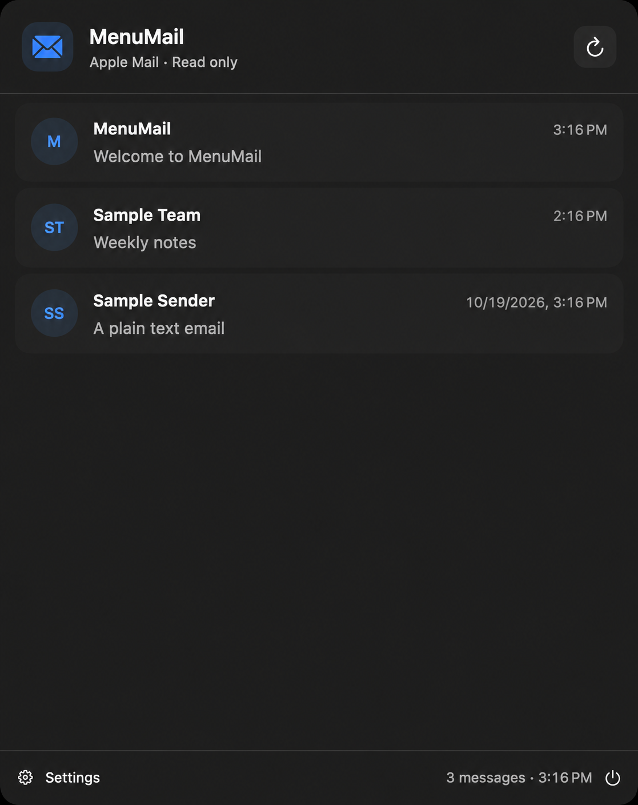
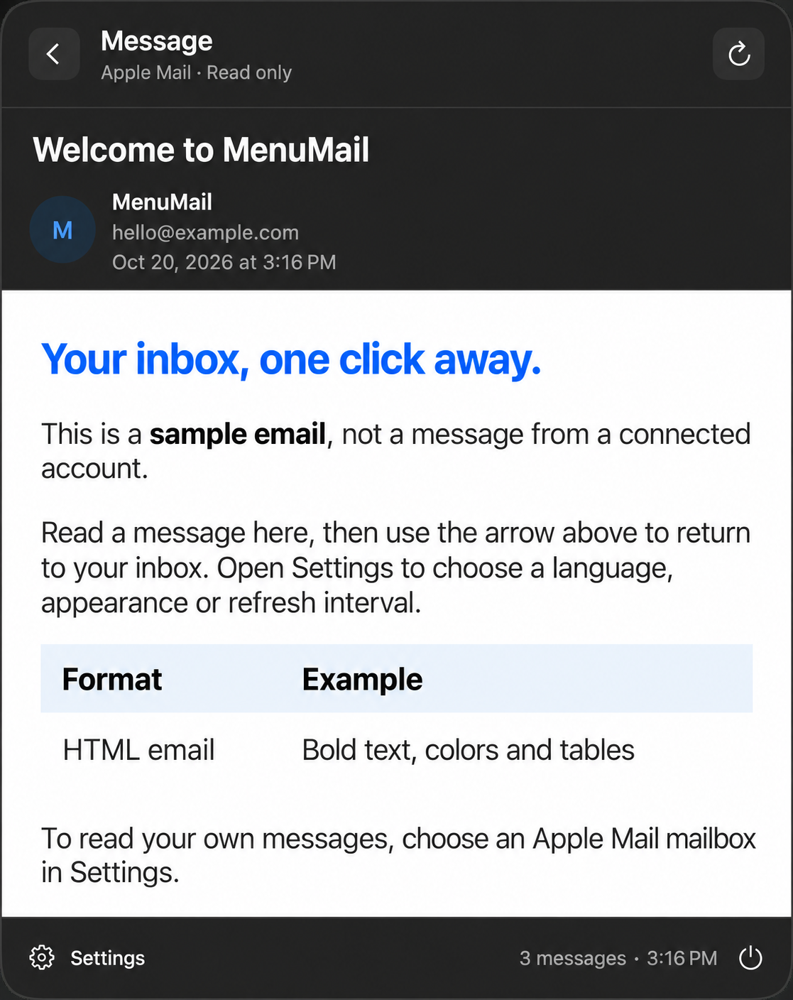
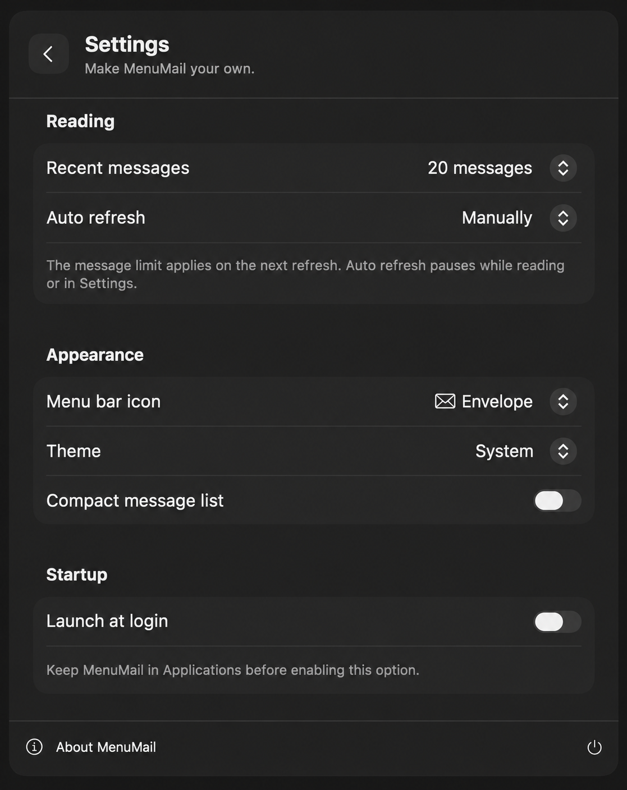

<p align="center">
  
</p>
<h1 align="center">MenuMail</h1>
<p align="center">Gelen kutun, bir tık uzağında. Mac’in menü çubuğunda.</p>
<p align="center">
  <a href="https://github.com/berkinduz/menu-mail/releases/latest/download/MenuMail.dmg"><strong>Mac için indir</strong></a> ·
  <a href="README.md">English</a> ·
  <a href="https://github.com/berkinduz/menu-mail/issues">Geri bildirim</a>
</p>

<p align="center">
  
  
  
</p>

MenuMail, **Apple Mail’e zaten eklenmiş hesabını** kullanan, ücretsiz ve açık kaynak bir **macOS menü çubuğu mail okuyucusudur**. Uygulamalar arasında geçiş yapmadan son maillerini oku. MenuMail seçtiğin posta kutusunu hatırlar.

### Diğer mail uygulamaları yönetici onayı istediğinde

Kurumsal **Microsoft 365 (Office 365) ve Exchange** hesapları, yalnızca onaylı mail uygulamalarında oturum açılabilecek şekilde sınırlandırılabilir. Başka bir uygulamada şirket mailinle giriş yapman engellenebilir veya **[“Need admin approval” (Yönetici onayı gerekiyor)](https://learn.microsoft.com/en-us/troubleshoot/entra/entra-id/app-integration/troubleshoot-consent-issues)** mesajıyla karşılaşabilirsin.

Kurumun hesabını **Mac’te Apple Mail üzerinden kullanmana zaten izin veriyorsa**, MenuMail aynı posta kutusunu macOS’un yerel Mail otomasyonu aracılığıyla okuyabilir. Böylece **iş maillerine macOS menü çubuğundan erişirsin**; MenuMail için **ayrıca sağlayıcıya giriş yapman veya Microsoft Entra uygulama kaydı oluşturman gerekmez**.

**[Apple Mail’de oturum aç](https://support.apple.com/guide/mail/mail35803/mac) → MenuMail’i bağla → Maillerini menü çubuğundan oku.** Oturum açma ve sunucu eşitlemesini Apple Mail yönetir; macOS sorduğunda MenuMail’in Mail’e erişmesine izin verirsin.

### Bir dakikada kur

1. [MenuMail.dmg dosyasını indir](https://github.com/berkinduz/menu-mail/releases/latest/download/MenuMail.dmg), **MenuMail’i Uygulamalar’a** sürükle.
2. Uygulamayı aç, menü çubuğundaki zarfa tıkla ve **Connect Apple Mail** seçeneğini kullan.
3. macOS sorarsa Mail erişimine izin ver. Gerekirse hesabını ve posta kutunu seç.

**macOS 14+ · Apple silicon ve Intel · Hazır uygulama için Xcode gerekmez.**

Bu sürüm **notarize edilmedi**. macOS, ilk açılışta **Sistem Ayarları → Gizlilik ve Güvenlik** üzerinden onay isteyebilir. [Apple’ın rehberi](https://support.apple.com/en-us/102445).

### Küçük uygulama, kullanışlı detaylar

- Tam HTML ve düz metin okuma; tek tıkla listeye dönüş.
- Varsayılan **son 20 mail**; istersen 10, 20 veya 50 seç.
- Elle veya otomatik yenileme, açık/koyu tema ve kompakt liste.
- Menü her açıldığında gelen kutusu yenilenir; Apple Mail kontrol edilirken mevcut liste kullanılabilir kalır.
- Dört menü çubuğu simgesi ve isteğe bağlı **oturum açılışında çalıştırma**.
- Varsayılan dil İngilizce. **Settings → App language → Türkçe** yoluyla değiştir.

**Gizlilik:** Hesabın Apple Mail’de kalır. MenuMail’in sunucusu yoktur; şifre istemez, mail içeriğini kaydetmez veya loglamaz. Mail göndermez, silmez, taşımaz ve okundu durumunu değiştirmez. Maillerdeki uzak görseller kendi adreslerinden yüklenebilir. [Detaylar](docs/PRIVACY.md).

### Geliştir veya katkı ver

Hata bildirimi, çeviri ve odaklı pull request’lere açığız. [Katkı rehberi](CONTRIBUTING.md).

```sh
git clone https://github.com/berkinduz/menu-mail.git
cd menu-mail
bash scripts/build.sh
open build/MenuMail.app
```

Swift 6+ ve macOS 14+ gerekir. `bash scripts/package.sh` universal DMG ve ZIP üretir. Aynı anda bir posta kutusu kullanılır; hesap girişi ve sunucu eşitlemesi Apple Mail’dedir.

---

Geliştiren: [berkinduz](https://github.com/berkinduz) · [İletişim](mailto:mberkinduz@gmail.com) · [MIT Lisansı](LICENSE)

### Sonraki adımlar · Katkıya açık

- [ ] **Gerçek Apple Mail entegrasyon kontrolleri:** farklı macOS sürümlerinde ilk kurulum izinleri, Mail açık/kapalı durumu, bağlantı hataları, HTML içerik ve geri/yenileme akışları. Sonuçları birim testlerinden ayrı raporlama.
- [ ] **Daha hızlı gezinme:** global klavye kısayolu, ok tuşlarıyla gezinme, Enter/Escape kontrolleri ve yüklenen son maillerde arama.
- [ ] **Sürüm bildirimleri:** yeni sürüm çıktığında indirme bağlantısıyla haber verme; ardından uygulama içinden güncellemeyi değerlendirme.

Katkı vermek ister misin? Bir maddeyi konuşmak için [issue aç](https://github.com/berkinduz/menu-mail/issues), ardından [katkı rehberini](CONTRIBUTING.md) izle.
